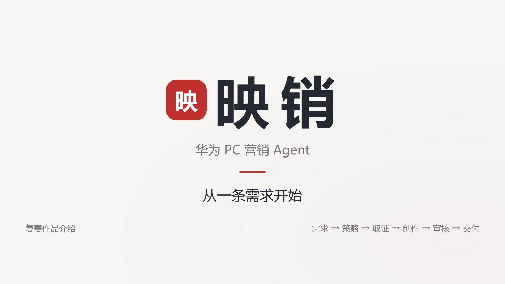

# 映销 · 90秒宣传片与Remotion工程

这是2026-10-22已完成的原版，2026-10-23同步到GitHub与魔搭。横屏1920×1080、30FPS、2700帧，画面90.0秒；中文原旁白、烧录字幕、原创配乐及音效。此次未重配音或重渲染。

## 成片与可直接读取的资料

- [带配乐成片](exports/映销-90秒-宣传片.mp4) · [无配乐版](exports/映销-90秒-无配乐版.mp4) · [字幕SRT](exports/映销-90秒-中文字幕.srt) · [封面](exports/映销-宣传片封面.jpg)
- [完整旁白原文](docs/narration.md)：按8段自然语义整理，逐字保留实际台词。
- [旁白、字幕与画面完整时间轴](docs/voiceover_timeline.md)：起止时间、33条字幕、画面和替换配音注意事项。
- [原始旁白与12镜时间](src/narration.json)、[实际33条字幕与音频时序](src/captions.json)、[独立音频文件](public/audio/)。
- [统一交接索引](../docs/video-handoff.md)、[全部公开文件校验](manifest.json)。



完整工程直接随仓库提供。克隆仓库或下载仓库ZIP后进入video目录，不需要本机原来的独立目录，也不需要完整知识库和DeepSeek密钥。node_modules、模型权重、Python环境和原始业务日志不随仓库分发。

## 修改与再渲染

需要Node.js 22+、npm和可用的Chrome/Edge/Chromium。

```sh
cd video
npm run verify  # 无需安装依赖即可校验已发布文件、旁白和字幕
npm ci
npm run dev
# 需要导出新版本时执行：
npm run render
npm run render:nobgm
```

注册入口src/index.ts，规格src/Root.tsx，主合成src/Main.tsx，场景src/Scenes.tsx，多轨src/workbench.ts。修改上述内容会影响后续渲染；下载现有MP4无需安装运行环境。浏览器自动检测本机Playwright、Chrome或Edge，可用CHROME_PATH显式指定。

当前两版成片来自同一时间线：无配乐交付版复用主版视频流，并使用bgm:false真实渲出的独立音轨，因此两版2700帧逐帧一致。未来两次独立H.264渲染可能有细微像素差，不能仅凭同一个工程声称逐帧一致。

旁白为Kokoro ONNX v1.1-zh、zf_001本地合成，未克隆真人；不是豆包Seed-TTS新配音。public/audio中33个WAV是实际运行源文件，BGM与SFX独立。两版MP4都是混合音轨，无配乐版仍有旧旁白，换配音应从工程替换WAV并同步时间轴，不能直接叠加新声音。

scripts/voice.py与download_voice_model.py仅供后续重新合成时参考，会修改音频、字幕及记录，不是重现当前MP4的必要步骤。scripts/score.py记录原创120BPM配乐与riser；现有音频已随工程提供。

## 画面来源与制作记录

[制作说明](docs/制作说明.md)、[音频与素材](docs/音频与素材.md)、[历史独立终检](docs/独立终检.md)记录镜头配方、来源和技术测量。页面纹理为真实工作台加载2026-10-18历史验收结果后采集的脱敏截图，画面标注本地资料与历史实测，不是当前魔搭在线生成录像，不表示华为官方背书。

scripts/capture.cjs是历史采集方法参考，不参与现有工程渲染。重新采集需另备授权历史记录、对应业务页面版本和本地知识库，通过CAPTURE_HISTORY_ROOT、CAPTURE_APP_ROOT、KNOWLEDGE_ROOT指定；还需自行安装Playwright。不得将私有业务JSON或完整资料上传到公开仓库。当前冻结PNG已足够渲染本片。

## 可选动效工作台

源自[video-shotcraft](https://github.com/Vincentwei1021/video-shotcraft)，制作时版本43bd349。需要工作台时另行克隆该工具至本仓库下video-shotcraft目录，并按workbench-windows-adapter/README.txt恢复Windows适配，再从video目录运行：

```sh
node ../video-shotcraft/workbench/scripts/open.mjs .
```

基础Remotion渲染不依赖该工具。Remotion有[独立许可](https://github.com/remotion-dev/remotion/blob/main/LICENSE.md)；上游SFX来源和许可见素材记录，产品图片不构成版权归属声明。
